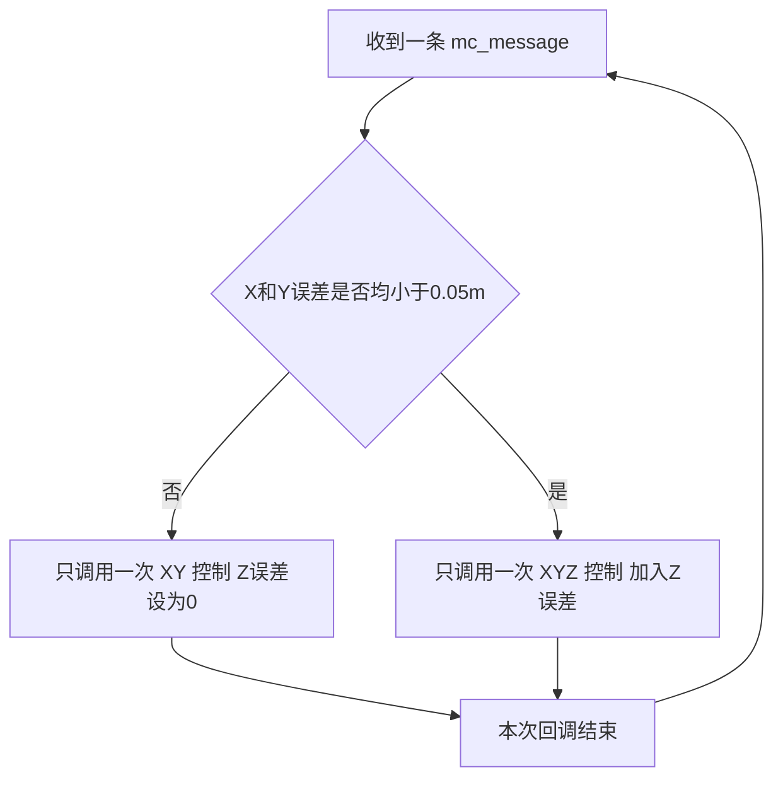

# 从输入 dock 到机器人运动：ArUco 定位与对接代码全流程

> **当前控制实现更新（2026-11-15）：** 已加入视觉有效性/时间戳、Z速度双环、15cm HOLD和dock时航向保持。当前运行链路以 [对接保持修订说明](aruco_docking_hold_update.md) 为准。本文第8～18节中“单环/到高度关电机/X型无yaw”等内容保留为旧版代码学习背景，不再是当前dock的实现；相机成像、ArUco位姿求解和Tbc变换的解释仍适用。

本文按当前工作空间的源码解释，核对日期为 **2026-11-15**。入口是：

```bash
bash src/gazebo_launch/aruco_docking.sh
```

启动完成后，在 `aruco>` 提示符后输入 `dock`。

**2026-11-09 启动器修正说明：** 现在默认 `WAIT_PAUSED=true`。节点准备完成后，脚本会用 Gazebo 服务重置机器人初始位姿和速度，取得定位后暂停物理；等待命令时图像冻结，避免 IDLE 被动漂移。输入 dock 会先恢复物理并取得新鲜检测再发命令；st 停止并暂停；reset 回到初始位置；quit 按运行标记清理包括独立 session 在内的子节点。这个教学准备动作使用 Gazebo 真值接口，不是视觉定位或自动悬停，输入 dock 后的控制算法仍按下文分析执行。可设置 WAIT_PAUSED=false 恢复持续运行模式。


本文会把每一步的“输入是什么、哪个函数处理、变量变成什么、交给谁”串起来。示例中的连续运动坐标是**帮助理解的假设过程**，不是已经实测收敛的轨迹。本文没有修改控制程序，也没有启动新的仿真。

当前实现已有“图像定位 → 相对位置反馈 → XY 对准 → Z 向接近”的链路；2026-11-15 增加机体系 15 cm 高度目标与到达后停机，但尚无接触/锁定成功判定。所以下文会讲到实际代码的终点，并明确哪些动作还没有实现。

建议分三遍阅读：第一遍看第 1、5、8～11、16～18 节，理解整体动作；第二遍看第 6～7、12～15 节，对照函数和数值；第三遍用第 19～21 节检查自己的仿真日志和理解。

本文追踪的是当前 `dock` 命令。另一条 `docking` 路径规划、无人机 `aruco_demo.cpp` 和旧的 `motion_control0/` 不属于本次脚本的实际控制入口。

## 1. 先认识整个系统：五条链路同时工作

这些节点是不同进程，靠 ROS 话题通信，不能理解成一个 `main()` 从头按顺序调用完所有函数。只有同一个节点内部才是普通函数调用；跨节点的箭头表示“发布消息 → 另一个进程收到回调”。

```mermaid
flowchart TD
    S[aruco_docking.sh] --> G[Gazebo 世界和动态机器人]
    S --> D[decision 决策节点]
    S --> M[motion 运动节点]
    G --> C[底部相机图像与 CameraInfo]
    C --> A[aruco_det 检测与位姿估计]
    A --> P[aruco_posture 坐标转换]
    P --> D
    U[用户输入 dock] --> CMD[/robot1/cmd_message]
    CMD --> D
    CMD --> M
    D --> MC[/robot1/mc_message]
    MC --> M
    M --> PID[位置误差到控制力]
    PID --> AL[推力分配与腿部角度]
    AL --> PWM[/robot1/pwm_message]
    PWM --> J[joint_control 关节转向]
    PWM --> T[thruster_control 推进器输入]
    J --> G
    T --> G
    G --> C
    G --> F[模型真值 IMU 压力反馈]
    F --> D
```

可以分成五条线理解：

| 链路 | 主要负责什么 | 输入 dock 之前是否运行 |
| --- | --- | --- |
| 启动线 | 生成世界、机器人、标记，启动其他节点 | 是 |
| 视觉线 | 相机出图、识别标记、求相对位姿 | 是 |
| 命令线 | 设置决策跟踪标志和运动模式 | 等待用户命令 |
| 控制线 | 根据相对误差计算控制输出 | 节点已运行，初始模式是 IDLE |
| 诊断线 | 记录位姿、真值、状态和误差 | 是 |

**输入 dock 不会启动相机。相机早已在运行；dock 让运动节点开始使用已在更新的视觉结果。**

## 2. 阅读源码时从哪些文件开始

下面链接均相对于本文所在的 `learn/` 目录，可直接打开源码。

| 文件 | 重点函数或配置 | 在流程中的作用 |
| --- | --- | --- |
| [aruco_docking.sh](../src/gazebo_launch/aruco_docking.sh) | `start_background()`、`wait_ready()`、命令循环、`cleanup()` | 单终端启动和命令转发 |
| [wait_aruco_docking.py](../src/gazebo_launch/wait_aruco_docking.py) | `wait_detection()`、`fresh_pose()`、`wait_command()` | 发送 dock 前的就绪检查 |
| [gazebo_sensors.xacro](../src/new_gazebo_model/urdf/gazebo_sensors.xacro) | `bottom_camera` 宏 | 相机安装、成像参数、图像话题 |
| [aruco_det.cpp](../src/asrobot/src/aruco_det/aruco_det.cpp) | `camera_infoCallback()`、`cam_imageCallback()`、`main()` | 图像到标记相机系位姿 |
| [aruco_posture.cpp](../src/asrobot/src/aruco_det/aruco_posture.cpp) | `aruco_pos_cb()`、`main()` | 相机系位姿到机体系位姿 |
| [decision.cpp](../src/asrobot/src/decision_center/decision.cpp) | `downCamCallback()`、`cmdcallback()`、`motion_control_pub()` | 接收视觉、启用跟踪、组织控制消息 |
| [motion.cpp](../src/asrobot/src/motion_control/motion.cpp) | `cmdcallback()`、`mccallback()`、`handle_docking_aruco()` | 切换模式、XY/Z 接近逻辑 |
| [f_single_robot_control.cpp](../src/asrobot/src/motion_control/f_single_robot_control.cpp) | `PidXYZControl_X()` | 对接参数转交给组合控制器 |
| [c_sim_3d_ctrl.cpp](../src/asrobot/src/motion_control/c_sim_3d_ctrl.cpp) | `updateControl()`、`updatePidControl()`、`handleShapeX_SingleLoop_Control()` | 误差计算、PID 和力输出 |
| [c_controller_group.cpp](../src/asrobot/src/motion_control/c_controller_group.cpp) | `PID::pidNewCalcWithIntegral()` | 具体 PID 算法 |
| [c_vectoredthrustcontrol.cpp](../src/asrobot/src/motion_control/c_vectoredthrustcontrol.cpp) | `space3DControl()`、`calcSprayForces_Shape_X_2()`、`yawLocomMode_X()`、`thrusterforce2speed_X()` | 控制力到四腿角度与四个推进器指令 |
| [c_legmodel.cpp](../src/asrobot/src/motion_control/c_legmodel.cpp) | `leg::set_angle()` | 腿部角度装入 PWM 消息 |
| [joint_control.cpp](../src/asrobot/src/gazebo_commu/joint_control.cpp) | `pwmcallback()`、`publish()` | 关节命令校准和转发 |
| [thruster_control.cpp](../src/asrobot/src/gazebo_commu/thruster_control.cpp) | `pwmcallback()` | 四个推进器命令转发 |
| [aruco_pose_logger.py](../src/asrobot/scripts/aruco_pose_logger.py) | `relationships()`、`sample()` | 记录坐标关系，不参加控制 |

`c_vectoredthrustcontrol.cpp` 中保留了大段 `/* ... */` 旧实现，搜索会看到同名函数。本文描述的是**没有被注释掉的实现**：当前有效的 X 型分配函数使用 `base_motor_force=1.6`，不要把旧注释代码里的 `2.8` 当成生效参数。

## 3. 启动脚本先准备了什么

### 3.1 默认初始条件

来自 `aruco_docking.sh` 和它调用的 launch：

| 参数 | 本次脚本默认值 | 意义 |
| --- | --- | --- |
| `ROBOT_X / ROBOT_Y / ROBOT_Z` | `0 / 0 / -0.1 m` | 机器人机体原点的初始世界位置 |
| `MARKER_X / MARKER_Y / MARKER_Z` | `0.10 / 0 / -1.0 m` | 标记原点的世界位置 |
| 机器人初始 yaw | `0 rad` | 本脚本未覆盖模型 launch 的零航向默认值 |
| `enable_bottom_camera` | `true` | 实例化底部相机 |
| `static_model` | `false` | 机器人可运动，启用动力学插件 |
| 标记字典 `dictionary_id` | `10` | 本机 OpenCV 的 `DICT_6X6_250` |
| 当前外码 ID | `5` | 本场景实际放入的标记 |
| `aruco_length_outer` | `0.20 m` | 黑色标记外边框的实际边长 |
| `use_camera_info` | `true` | 使用相机发布的实际标定 |
| `camera_x / camera_y / camera_z` | `0 / 0 / -0.12 m` | 光心在机体系的位置 |
| `position_z_offset` | `0 m` | 不另加旧版的固定 Z 补偿 |
| `pose_timeout` | `0.5 s` | 转换节点接受视觉结果的有效时间 |
| `LOG_RATE` | `2 Hz` | 位姿日志采样频率 |
| `WAIT_PAUSED` | `true` | 准备后及 st 后暂停物理，dock 前恢复 |

标记模型在 [model.sdf](../src/gazebo_world/models/aruco_demo_marker/model.sdf) 中是静态、水平朝上的视觉平面。整张纹理平面边长 `0.28 m`，其中黑色标记外边框边长是 `0.20 m`。位姿求解使用的是后者。

动态机器人会受到重力、水动力和控制输出影响，启动期间就可能偏离初始位置。表中的初始条件不意味着输入 dock 时仍精确保持这些坐标。

### 3.2 脚本中的启动次序

`start_background()` 使用 `setsid` 在后台启动各进程，标准输出写入本次 `logs/aruco_docking_.../`。`wait_ready()` 检查上一阶段就绪后才继续：

```text
世界服务可用
  → 动态机器人已生成、controller_manager 可用
  → 关节控制器 running
  → 生成标记
  → 启动 decision / motion / joint_control / thruster_control
  → 确认 mc_message 有有效反馈
  → 启动 aruco_det / aruco_posture / aruco_pose_logger
  → 确认两个命令接收节点已订阅
  → 重置机体初始位姿和零速度
  → 检查模型、标定、视觉位姿和机体输出
  → 暂停物理，显示 aruco>，等待输入
```

运行时的 `asrobot.launch` 显式设置 `enable_aruco=false`，因为脚本随后另起 `aruco_det.launch`，并传入 `aruco_length_outer=0.2`，避免重复节点和错误边长。

脚本不自动发送 dock。它负责拉起现有控制系统，不生成新的运动轨迹。

## 4. 相机如何在 Gazebo 中运行

### 4.1 bottom_camera 宏定义了安装和光学参考系

`gazebo_sensors.xacro` 中：

```xml
<joint name="${namespace}/camera_bottom_joint" type="fixed">
  <parent link="${namespace}/base_link"/>
  <child link="${namespace}/camera_bottom_link"/>
  <origin xyz="0 0 -0.12" rpy="0 ${pi/2} 0"/>
</joint>

<joint name="${namespace}/camera_bottom_optical_joint" type="fixed">
  <parent link="${namespace}/camera_bottom_link"/>
  <child link="${namespace}/camera_bottom_optical_frame"/>
  <origin xyz="0 0 0" rpy="${-pi/2} 0 ${-pi/2}"/>
</joint>
```

第一个关节把相机安装在机体原点下方 `0.12 m`，并使 Gazebo 相机朝下；第二个关节定义用于图像和位姿计算的光学坐标系。两者合起来得到后面使用的 `Tbc`。

不要把 `camera_bottom_link` 与 `camera_bottom_optical_frame` 当成方向相同的坐标系。检测的 `frame_id` 是后者。

### 4.2 相机传感器与 ROS 相机插件

```xml
<sensor type="camera" name="camera_bottom">
  <always_on>true</always_on>
  <update_rate>30</update_rate>
  <camera>
    <horizontal_fov>${pi/2}</horizontal_fov>
    <image>
      <width>640</width>
      <height>480</height>
      <format>R8G8B8</format>
    </image>
    <clip><near>0.02</near><far>30</far></clip>
  </camera>
</sensor>
```

含义是：Gazebo 按相机位置和方向渲染 `640×480` 彩色图像，水平视场角 `90°`，传感器设置更新率 `30 Hz`。实际到达频率还受仿真速度和渲染性能影响。

`libgazebo_ros_camera.so` 把图像及标定信息送进 ROS：

```text
/gazebo_robot1/camera_bottom/image_raw
/gazebo_robot1/camera_bottom/camera_info
```

图像消息的 `header.frame_id` 是：

```text
gazebo_robot1/camera_bottom_optical_frame
```

`rqt_image_view` 只是订阅并显示图像，控制链路不依赖它。关闭图像查看器，相机和定位仍然工作。

## 5. 先统一坐标和单位，否则后面的数字容易看反

### 5.1 本文的四个坐标系

| 符号 | 坐标系 | 本例如何理解 |
| --- | --- | --- |
| `w` | 世界系 world | 标记固定在世界 `(0.10,0,-1.0)` |
| `b` | 机器人机体系 body | 原点跟着机器人移动 |
| `c` | 相机光学系 camera optical | X 向图像右，Y 向图像下，Z 沿观察方向向前 |
| `a` | 标记系 ArUco | 原点通常是标记中心；旋转还取决于图案朝向 |

`Txy` 表示**把 y 系的坐标变换到 x 系**。例如：

```text
Tca：标记系 → 相机系；也描述标记在相机系中的位姿
Tbc：相机系 → 机体系；相机安装外参
Tba：标记系 → 机体系
Twb：机体系 → 世界系
```

矩阵乘法顺序是：

```text
Tba = Tbc × Tca
Twa = Twb × Tbc × Tca
```

### 5.2 当前相机的轴向关系

`aruco_posture.cpp` 中使用：

```cpp
Tbc.linear() << 0, -1, 0,
               -1, 0, 0,
                0, 0, -1;
Tbc.translation() = Eigen::Vector3d(0, 0, -0.12);
```

仅看位置，有：

```text
x_b = -y_c
y_b = -x_c
z_b = -z_c - 0.12
```

因此，标记位于机器人下方时：

- 相机朝下看，标记在它前方，`z_c > 0`。
- 在机体系里标记位于下方，`z_b < 0`。
- 两个 Z 不仅符号不同，还相差光心安装偏移 `0.12 m`。

### 5.3 用默认几何条件算一遍

假设机器人仍位于 `(0,0,-0.1)`，姿态为零：

```text
机器人世界位置：  (0,    0, -0.10)
相机世界位置：    (0,    0, -0.22)
标记世界位置：    (0.10, 0, -1.00)
```

则标记相对机体的真实位置是：

```text
t_ba = (0.10, 0, -0.90) m
```

用轴向关系反推相机光学系：

```text
t_ca = (0, -0.10, 0.78) m
```

再从相机系转回机体系：

```text
x_b = -(-0.10)       = 0.10
y_b = -0            = 0
z_b = -0.78 - 0.12   = -0.90
```

这组数字会贯穿后文。它是理想几何值，实际视觉估计有像素、纹理渲染及姿态估计误差。

> 之前固定机器人在世界 Z=0 的静态日志，真值相机距离为 0.88 m，测得约 0.9014 m；动态脚本初始机器人 Z=-0.1，理想相机距离是 0.78 m。两次初始条件不同，不应混用。

## 6. aruco_det：从图像到相机系位姿

### 6.1 camera_infoCallback：读取相机内参

输入是 `sensor_msgs::CameraInfo`。函数检查焦距、畸变模型、数值有效性和畸变向量长度，然后构造：

```cpp
cameraMatrix = cv::Mat(3, 3, CV_64F);
std::copy(msg->K.begin(), msg->K.end(), cameraMatrix.ptr<double>());
distCoeffs = count == 0 ? cv::Mat::zeros(5, 1, CV_64F)
                       : cv::Mat(msg->D, true);
```

这里：

```text
cameraMatrix = K = [fx  0 cx]
                   [ 0 fy cy]
                   [ 0  0  1]

distCoeffs = 镜头畸变参数
```

这两个变量是**相机成像模型**，不是标记位置。相机位置变了，内参通常不跟着变；图像分辨率或镜头视场角变了，则应重新核对内参。

本例之前运行的日志记录了约：

```text
fx = fy = 319.9988 像素
cx = 320.5，cy = 240.5 像素
D = [0,0,0,0,0]
```

简单针孔投影关系是：

```text
u = fx × X/Z + cx
v = fy × Y/Z + cy
```

已知标记实际边长 `L`、图像中边长约 `l` 像素且接近正对相机时，可直观理解为 `Z ≈ fx×L/l`。本例 `L=0.2`、`Z=0.78` 时，边长约 `82` 像素。真正的位姿函数使用四个角点同时估计旋转和平移，不只靠这一条近似公式。

主循环发现 `cameraMatrix.empty()` 时会等待标定，尚不进行有效位姿计算。

### 6.2 cam_imageCallback：收到图像，缓存一帧

```cpp
cv_ptr = cv_bridge::toCvCopy(msg, sensor_msgs::image_encodings::BGR8);
frame = cv_ptr->image.clone();
image_header = msg->header;
new_frame = true;
```

函数只做三件事：转成 OpenCV 可用的 BGR 图像、保留原采集时间与参考系、标记有新帧。

后续 `main()` 才执行检测。处理结束把 `new_frame=false`；没有收到下一张图像时，不把同一张缓存图反复当成新检测发布。

### 6.3 main：提取标记 ID 和角点

检测循环设置为 `10 Hz`，每轮先 `ros::spinOnce()` 更新回调缓存：

```cpp
if (new_frame && !frame.empty() && !cameraMatrix.empty())
{
    new_frame = false;
    cv::cvtColor(current_frame, gray, cv::COLOR_BGR2GRAY);
    cv::aruco::detectMarkers(gray, dictionary,
                            markerCorners, markerIds,
                            parameters, rejectedCandidates);
}
```

输出：

| 变量 | 含义 | 本场景可能的值 |
| --- | --- | --- |
| `markerIds` | 每个成功识别标记的编号 | `[5]` |
| `markerCorners[i]` | 第 i 个标记四个角点的图像坐标 | 四个 `(u,v)`，单位像素 |
| `rejectedCandidates` | 未通过解码等检查的候选框 | 辅助诊断，主控制不使用 |

**识别出 ID 只说明找到了哪张图案；角点此时仍是像素，还没有得到米制距离。**

### 6.4 大小码选择：同心 ID 5/18 远近切换

源码有两个目标：

```text
外码：ID 5，动态脚本传入边长 0.20 m
内码：ID 18，默认边长 0.02 m
```

状态变量初始化为：

```cpp
int current_target_id = aruco_id_outer;
float current_target_length = aruco_length_outer;
int inner_marker_lost_count = 0;
```

切换条件：

- 当前是外码：外码相机 Z 小于 `0.5 m`，且内码也可见，才切到内码。
- 当前是内码：内码相机 Z 大于 `0.7 m`，或连续丢失达到默认 `100` 次处理帧，尝试切回外码。
- 真正切换到另一目标时，同时更新目标 ID 和实际边长。

2026-11-15 已把当前场景纹理改成同心双码：外码 ID5/0.20 m，内码 ID18/0.02 m。相机 Z 小于 0.5 m 且小码可见时切换到内码。两个码中心、朝向一致，避免因目标中心不同而跳变；仍有像素量化和位姿估计误差。

丢失计数只统计主循环处理的新帧，检测最多约 10 Hz，不等于相机的 30 Hz；不能把 100 次简单当成相机 100 帧的固定时长。

### 6.5 estimatePoseSingleMarkers：角点变成旋转和平移

选中目标后：

```cpp
cv::aruco::estimatePoseSingleMarkers(
    target_marker_corners_subset,
    current_target_length,
    cameraMatrix, distCoeffs,
    rvec_target_vec, tvec_target_vec);
```

输入是四个角点、实际边长和相机成像模型；输出是：

```text
rvec：标记系到相机光学系的旋转向量，不是 roll/pitch/yaw
 tvec：标记原点在相机光学系中的 (X,Y,Z)，单位米
```

从数学上可以理解为求解“某个大小已知的平面方形，在什么三维位置和朝向上，投影后最符合这四个像素角点”。不能只凭一张任意图像求绝对尺寸；已知标记边长提供了米制尺度。

对上述理想初始条件，得到的平移应接近：

```text
tvec ≈ (0, -0.10, 0.78)
```

边长如果错填成 `0.10 m`，同样角点对应的平移尺度会约缩小到一半，后面的控制误差也跟着错。

### 6.6 发布 /aruco/pose

位置直接使用 `tvec`。姿态先把旋转向量转为矩阵，再转单位四元数：

```cpp
cv::Rodrigues(rvec_target, rotation_matrix);
tf_rot_matrix.getRotation(tf_quat);
tf_quat.normalize();
aruco_det_pose.pose.orientation = tf2::toMsg(tf_quat);
aruco_det_pose.header.stamp = image_header.stamp;
aruco_det_pose_pub.publish(aruco_det_pose);
```

消息类型是 `geometry_msgs::PoseStamped`：

```text
header.stamp = 原图像时间
header.frame_id = gazebo_robot1/camera_bottom_optical_frame
pose.position ≈ (0, -0.10, 0.78)
pose.orientation = 标记系到相机系的四元数
```

标记没检测到时，不发布新的位姿。`/aruco_det_image` 是另一条带边框与坐标轴的显示图像，不是控制消息；框和坐标轴是求解后画上去的。

## 7. aruco_posture：相机系位姿变为机体系位姿

### 7.1 aruco_pos_cb：验证后构建 Tca

输入为 `/aruco/pose`：

```cpp
if (msg->header.frame_id != camera_frame_id)
    return;

Eigen::Quaterniond q(p.orientation.w, p.orientation.x,
                     p.orientation.y, p.orientation.z);
Eigen::Vector3d t(p.position.x, p.position.y, p.position.z);
Tca.linear() = q.normalized().toRotationMatrix();
Tca.translation() = t;
pose_stamp = msg->header.stamp;
have_pose = true;
```

函数还检查四元数非零、所有值有限。`have_pose` 初始是 false，在收到首个有效位姿后变为 true；它本身不是“当前仍然可见”的状态，是否过期由时间检查决定。

### 7.2 main：安装外参左乘视觉结果

```cpp
const double age = (ros::Time::now() - pose_stamp).toSec();
if (!have_pose || age < 0 || age > pose_timeout)
    continue;

const Eigen::Isometry3d Tba = Tbc * Tca;
```

`Tbc` 是固定安装关系，`Tca` 随视觉检测变化。相乘得到 `Tba`，其中平移就是标记相对机体原点的位置。

对前述例子：

```text
Tca.translation = (0, -0.10, 0.78)
             ↓ Tbc × Tca
Tba.translation = (0.10, 0, -0.90)
```

旋转也同步变换。函数把 `Tba.rotation()` 转为四元数，再算出 RPY，乘 `180/π` 得到度。

### 7.3 发布 /camera_aruco_data

```cpp
data.position_x = Tba.translation().x();
data.position_y = Tba.translation().y();
data.position_z = Tba.translation().z() + z_offset;
data_pub.publish(data);
```

本例 `z_offset=0`，发布值约为：

```text
position_x = 0.10 m
position_y = 0 m
position_z = -0.90 m
cam_roll / cam_pitch / cam_yaw = 标记相对机体的姿态，单位度
```

转换循环是 `20 Hz`，因此同一张有效视觉结果可能发布多次；它不会把图像原始时间无限刷新。超过 `0.5 s` 后停止发布机体结果。

消息类型 `asrobot::camera_data` 没有 header，也没有显式“目标丢失”字段。上游停止发布，不等于下游已保存的数值被清零。

### 7.4 Gazebo 世界位姿在这里的作用

`modelStatesCallback_()` 读取机器人真值，构建 `Twb`。代码可计算：

```cpp
const Eigen::Isometry3d Twa = Twb * Tba;
```

但当前控制消息发布的仍然是 `Tba`。`Twa` 仅用于调试，日志也会计算这个关系。

因此：视觉提供的是**标记相对相机的估计**；机器人世界坐标来自 Gazebo 真值，不是通过 ArUco 独立定位得到的机器人世界坐标。

## 8. 用户输入 dock 的瞬间，发生了什么

### 8.1 脚本先检查，不直接盲发命令

命令循环识别到 `dock` 后，先恢复物理，使 /clock 和相机继续更新，再调用：

```text
wait_aruco_docking.py detection --timeout 3
  → wait_detection()
  → fresh_pose()
```

检查内容包括：

- `gazebo_robot1` 和 `aruco_demo_marker` 存在。
- 相机焦距参数有效，并且相关消息最近收到。
- `/aruco/pose` 使用正确光学参考系，数值有限，四元数有效，相机 Z 为正。
- 图像时间相对当前 ROS 时间的年龄在 `[0,0.5] s`。
- `/camera_aruco_data` 的位置和姿态均为有限数值。

通过后才执行：

```bash
rostopic pub -1 /robot1/cmd_message std_msgs/String -- "dock"
```

这是发送一次字符串消息，不是每帧持续发送 dock。

### 8.2 同一条命令有两个接收者

[asrobot.launch](../src/asrobot/launch/asrobot.launch) 的 remap 和 `robot1` 命名空间，使以下两个函数都订阅 `/robot1/cmd_message`：

```text
decision.cpp::cmdcallback()
motion.cpp::cmdcallback()
```

它们各自处理消息，不保证哪一个回调先执行。

决策节点：

```cpp
if (cmd[0] == "dock" && cmd.size() == 1)
    tracking_aruco_flag = true;
```

状态变化：

```text
tracking_aruco_flag：false → true
```

运动节点：

```cpp
else if (cmd[0] == "dock")
    g_current_state = RobotMode::DOCKING_ARUCO;
```

状态变化：

```text
g_current_state：IDLE（或其他模式）→ DOCKING_ARUCO
```

一个负责“开始组织并发送视觉误差”，另一个负责“收到运动反馈时使用对接控制函数”。命令检查器在启动阶段确认两个节点都已订阅，避免首条命令没有送到其中一方。

运动节点 `cmdcallback()` 末尾还有一次影响 PID 历史的操作：

```cpp
if (g_current_state != previous_state)
    combine3DPidCtrl.resetManualPIDs();
```

这个函数虽然叫 `resetManualPIDs()`，内部也清空共享的 `mcXPID`、`mcYPID`、`mcDepthPID` 等经典 PID 历史。因此第一次从 IDLE 切换到 DOCKING_ARUCO 时，相关历史会重置，但增益参数不因此改变。若已经处于 DOCKING_ARUCO，又输入一次 dock，模式没有变化，就不会因这条条件再次重置。

两个节点的回调先后仍无保证。例如运动模式先切换时，可能先收到一条决策节点原来的普通反馈，再收到带新视觉字段的消息；就绪检查并不实现跨节点的原子切换。

## 9. decision：把视觉测量转成运动节点要用的消息

### 9.1 downCamCallback：持续更新最新视觉值

```cpp
aruco_pos_x = msg->position_x;
aruco_pos_y = msg->position_y;
aruco_pos_z = msg->position_z;
aruco_roll = msg->cam_roll;
aruco_pitch = msg->cam_pitch;
aruco_yaw = msg->cam_yaw;
```

输入 dock 前该回调就已经在执行。输入 dock 不会清空这些视觉变量。

在示例时刻：

```text
aruco_pos_x = 0.10
aruco_pos_y = 0
aruco_pos_z = -0.90
aruco_yaw ≈ 0°（标记与机体方向一致的假设）
```

### 9.2 主循环调用 motion_control_pub(TRACKING_ARUCO_MODE)

`tracking_aruco_flag=true` 后：

```cpp
motion_control_pub(TRACKING_ARUCO_MODE);
```

该函数的对应分支：

```cpp
motion.cam_e_x = aruco_pos_x;
motion.cam_e_y = aruco_pos_y;
motion.cam_e_z = aruco_pos_z;
motion.cam_e_yaw = aruco_yaw;

motion.cam_c_x = 0;
motion.cam_c_y = 0;
motion.cam_c_z = 0;
motion.cam_c_yaw = 0;
```

最后 `mc_pub.publish(motion)` 发布 `/robot1/mc_message`。

这里 `cam_e_*` 名字像“期望绝对位置”，实际放的是**标记相对机体的位移**；`cam_c_*` 设为零，配合后面 `期望−当前` 的接口，产生所需的相对误差。

```text
ex = cam_e_x - cam_c_x = 0.10 - 0 = 0.10
 ey = cam_e_y - cam_c_y = 0 - 0 = 0
 ez = cam_e_z - cam_c_z = -0.90 - 0 = -0.90
```

机器人并没有被误认为处于世界原点，而是在这个控制接口中，把**当前机体原点当作相对坐标零点**。

### 9.3 其他传感器与当前位姿从哪里来

同一决策节点还订阅：

| 回调 | 输入 | 更新内容 |
| --- | --- | --- |
| `modelStatesCallback()` | `/gazebo/model_states` | 机器人世界位置和速度 `robot_pos` |
| `imucallback()` | `/gazebo_robot1/imu` | 姿态角、角速度等 |
| `depcallback()` | `/gazebo_robot1/pressure` | 压力换算的深度等 |

因此这不是完全只靠视觉的系统。视觉给出相对目标，其他反馈也进入 `mc_message` 的一般状态字段。

### 9.4 一个会改变控制更新节奏的细节

当前编译开关同时为：

```cpp
#define TRACKING_ARUCO_SWITCH 1
#define SINGLE_ROBOT_DEBUG_SWITCH 1
```

主循环会先发 ArUco 模式消息，再发：

```cpp
motion_control_pub(SINGLE_ROBOT_DEBUG);
```

`motion` 是一个复用的全局消息。普通调试分支没有清空 `cam_e_* / cam_c_*`，所以第二条消息仍保留上一条写入的视觉字段，同时更新一般位置/速度等字段；不能说它必然把视觉目标覆盖成零。

影响是：一次决策循环可能触发两次运动回调，并在视觉没变时重复执行 PID。决策循环设置为 `5 Hz`，启用 dock 后通常会产生约 `10` 条运动消息/秒，实际频率受运行状态影响。

## 10. motion：收到 mc_message 后怎么分派

### 10.1 mccallback：先复制反馈和视觉参数

```cpp
cur_v_z = msg->c_speedz;

cam_exp_p_x = msg->cam_e_x;
cam_exp_p_y = msg->cam_e_y;
cam_exp_p_z = msg->cam_e_z;
cam_cur_p_x = msg->cam_c_x;
cam_cur_p_y = msg->cam_c_y;
cam_cur_p_z = msg->cam_c_z;
cam_cur_yaw = msg->cam_c_yaw;
cam_exp_yaw = msg->cam_e_yaw;
```

这一层没有重新识别图像，也没有重新转换坐标，只是把决策消息展开成运动节点的变量。

对于例子：

```text
cam_exp_p = (0.10,0,-0.90)
cam_cur_p = (0,0,0)
cam_cur_yaw = 0
```

### 10.2 设置控制模式，再进入 DOCKING_ARUCO

```cpp
combine3DPidCtrl.setControlMode(
    g_current_state == RobotMode::DEBUGVZ ||
    g_current_state == RobotMode::DEBUGPZ
      ? C_Combine3DPidControl::DUAL_LOOP
      : C_Combine3DPidControl::SINGLE_LOOP);
```

然后：

```cpp
case RobotMode::DOCKING_ARUCO:
    handle_docking_aruco(msg);
    break;
```

**DOCKING_ARUCO 在当前代码中使用 SINGLE_LOOP。** 后面某一行注释写“双环”，并不会改变这个实际设置。

`manual_pid` 判定也不包含 `DOCKING_ARUCO`，所以此模式下 `setManualPIDActive(false)`，手动模糊 PID 开关不会让 dock 自动使用模糊增益。

## 11. handle_docking_aruco：XY 对齐与 Z 接近的真实顺序

### 11.1 先判断 XY，每次回调只选择一个控制分支

当前代码先判断两个轴的误差是否都小于 `0.05 m`：

```cpp
// 此前先执行 15 cm 高度停止判定，见第 18 节。
const bool xy_aligned = std::fabs(cam_exp_p_x - cam_cur_p_x) < 0.05 &&
                        std::fabs(cam_exp_p_y - cam_cur_p_y) < 0.05;
if (xy_aligned)
{
    PidXYZControl_X(cam_exp_p_x, cam_exp_p_y, cam_exp_p_z,
                    cam_cur_p_x, cam_cur_p_y, DOCKING_MARKER_Z_TARGET,
                    cam_cur_yaw, cur_v_z);
}
else
{
    PidXYZControl_X(cam_exp_p_x, cam_exp_p_y, 0,
                    cam_cur_p_x, cam_cur_p_y, 0,
                    cam_cur_yaw);
}
```

- 两轴都小于阈值：只执行一次 XYZ 控制，加入标记 Z 相对误差。
- 任意一个轴不满足：只执行一次 XY 控制，目标和当前 Z 都传零。
- 恰好等于 `0.05 m` 也不满足严格小于条件。
- 每次消息重新判断；接近过程中若 XY 再次超出阈值，下一轮回到 XY 控制。

已移除旧的 `flag_xy/flag_z` 和每轮 `mcSpeedPID.pidReset()`；满足条件时不会先输出 XY 再输出 XYZ。当前仍是逐轮判断，没有持续阶段锁定或阈值回差。



### 11.2 第一个理想时刻：只做 XY

```text
cam_exp_p = (0.10,0,-0.90)
cam_cur_p = (0,0,0)
```

第一个调用传入：

```cpp
PidXYZControl_X(0.10, 0, 0,  0, 0, 0,  0);
```

所以 PID 看到：

```text
ex=0.10，ey=0，ez=0
```

它要求沿机体 X 正方向修正。由于 `0.10 < 0.05` 不成立，本轮不进入 Z 接近。

Z 误差置零意味着“这一轮不使用标记 Z 来产生新的位置误差”，**不代表建立了保持当前绝对深度的闭环**。水动力、重力、已有积分/微分状态和惯性仍可能造成 Z 方向变化。

### 11.3 第二个假设时刻：XY 进入阈值，加入 Z

假设机体已移动到世界 `(0.07,0,-0.1)` 且姿态仍为零，标记不动：

```text
标记相对机体 = (0.03,0,-0.90)
```

这一轮先判断 XY，发现两轴误差都小于 `0.05 m`，直接执行一次 XYZ 控制：

```cpp
PidXYZControl_X(0.03, 0, -0.90,  0, 0, -0.15,  0, cur_v_z);
```

此时 `ez=-0.90-(-0.15)=-0.75 m`，使控制器向 15 cm 目标间距接近。到达阈值后先执行停机，不再调用此 PID。

该行虽然传入 `cur_v_z`，但当前 `current_mode_` 是 SINGLE_LOOP，所以没有因此启用位置外环/速度内环。速度参数被存进类成员，当前单环分支并不使用它来闭环控制 Z。

### 11.4 日志和控制模式要按实际分支理解

对齐分支打印 `XY ALIGN`，接近分支打印 `XYZ APPROACH`，日志不再把第二阶段称为 `YAW ALIGN`。

当前 `PidXYZControl_X()` 没有接收 `cam_exp_yaw`，传给组合控制器的目标 yaw 是 0，X 型分配分支也未使用 `_yaw_force`；因此加入 Z 误差并不表示同时实现标记航向对准。DOCKING_ARUCO 仍为单环，传入 `cur_v_z` 的重载也不会自动切换成双环。

## 12. PidXYZControl_X：一个包装函数怎样调用下一个函数

短参数版本：

```cpp
void PidXYZControl_X(float ex, float ey, float ez,
                     float cx, float cy, float cz, float current_yaw)
{
    combine3DPidCtrl.setDebugMode(NAV_NORMAL);
    combine3DPidCtrl.updateControl(
        SHAPE_X,
        ex, ey, 0, ez,
        cx, cy, current_yaw, cz);
}
```

这里为方便阅读缩短了形参名，参数顺序与源码相同。

注意包装函数参数顺序是 `x,y,z,...`，而 `updateControl()` 期望的是：

```text
shape,
目标x, 目标y, 目标yaw, 目标z,
当前x, 当前y, 当前yaw, 当前z
```

因此中间那个 `0` 是目标 yaw，不能错读成目标 Z。

带速度版本额外传入目标速度零、XY 当前速度零以及 `cur_v_z`，仍然调用同一个类的重载。

接下来调用链是：

```text
PidXYZControl_X()
  → C_Combine3DPidControl::updateControl()
      保存 shape_、exp_p_*、cur_p_*、cur_yaw_ 等成员
  → updatePidControl()
      判断 shape_ == SHAPE_X 且 current_mode_ == SINGLE_LOOP
  → handleShapeX_SingleLoop_Control()
```

## 13. 单环位置 PID：相对距离如何变成控制力

### 13.1 误差先做减法

```cpp
float x_error = exp_p_x_ - cur_p_x_;
float y_error = exp_p_y_ - cur_p_y_;
float depth_error = exp_p_z_ - cur_p_z_;
```

决策消息的相对当前坐标设为零；运动节点在 XYZ 接近分支把传给 PID 的当前 Z 参考改为 `-0.15`，因此误差为 `测得标记Z+0.15`。XY 阶段仍将两个 Z 参数都传零。

```cpp
desired_world_x_force = calculateManualPID(vec_ctrl.mcXPID, ...);
desired_world_y_force = calculateManualPID(vec_ctrl.mcYPID, ...);
```

`calculateManualPID()` 中，当前 `manual_pid_active_=false`，直接走经典 `base.pidNewCalc(error)`。

Z 的非手动路径调用：

```cpp
vec_ctrl.mcDepthPID.pidNewCalcWithIntegral(depth_error,
                                         classic_z_accumulate);
```

当前积分分离阈值为 `0.1 m`：大误差时不继续累积 Z 积分，但不清除已有积分。Z 积分和限幅在实际输出中仍有影响。

### 13.2 当前启动增益和 PID 实现

`motion.cpp::main()` 调用参数设置函数，最终修改组合控制器的 PID 成员：

| 成员 | Kp | Ki | Kd |
| --- | ---: | ---: | ---: |
| `mcXPID` | 0.6 | 0 | 0.5 |
| `mcYPID` | 0.6 | 0 | 0.5 |
| `mcDepthPID` | 1.6 | 0.02 | 0.1 |

`PID::pidNewCalc()` 委托给 `pidNewCalcWithIntegral()`。核心是：

```cpp
if (accumulate)
    fError_i += fError;
fError_d = fError - fLastError;
fLastError = fError;

fLastP = fP; fLastI = fI; fLastD = fD;
fP = fKp * fError;
fI = fKi * fError_i;
fD = fKd * fError_d;
output = (fP + fI + fD + fLastP + fLastI + fLastD) / 2;
```

源码还对积分累积做限幅。它是带前后两次项平均的离散实现，积分是逐次累加、微分是逐次差值，没有显式乘除 `dt`。因此重复消息和调用次数会影响控制结果，不能只看某一帧距离就推断精确推力。

举一个**控制器历史全零且刚执行一次**的算例，`ex=0.10`：

```text
P = 0.6 × 0.10 = 0.06
I = 0
D = 0.5 × (0.10 - 0) = 0.05
前一次 P/I/D = 0
输出 = (0.06 + 0 + 0.05 + 0) / 2 = 0.055
```

这是函数计算示例，不代表真实 dock 第一帧一定输出 0.055。模式切换虽然会重置历史，但回调先后、重复消息及实际视觉误差会影响第一次有效目标到来前后的 PID 状态；重复输入 dock 而不切换模式时也不会重置历史。

### 13.3 “世界系力”变量名在此处如何理解

源码接着旋转 XY 力：

```cpp
float yaw_rad = cur_yaw_ * M_PI / 180.0;
Fx_body = Fx_world * cos(yaw_rad) + Fy_world * sin(yaw_rad);
Fy_body = -Fx_world * sin(yaw_rad) + Fy_world * cos(yaw_rad);
```

普通世界位置控制需要这个旋转。但 dock 分支送进来的误差已经在机体系，并把 `cam_cur_yaw=0`：

```text
cos(0)=1，sin(0)=0
Fx_body=Fx_world，Fy_body=Fy_world
```

所以在当前调用方式下，这层旋转等效为不旋转。变量名 `desired_world_*` 是通用控制器的命名，不能据此认为视觉位置已变成世界坐标。以后若把真实世界 yaw 直接填进来而不同时修改输入参考系，就可能错误地再次旋转。

最后调用：

```cpp
vec_ctrl.space3DControl(SHAPE_X,
                       desired_robot_x_force,
                       desired_robot_y_force,
                       desired_z_force,
                       0);
```

输出是控制分配所用的力量级指令，尚不是 Gazebo 电机的输入，也不能假定它与最终实现的净力完全相同。

## 14. 推力分配：三轴控制量怎样变成四个电机和四腿角度

### 14.1 space3DControl：根据形态选择分配方法

有效实现的 X 分支：

```cpp
case SHAPE_X:
    calcSprayForces_Shape_X_2(Fx, Fy, Fz,
        &force1, &force2, &force3, &force4,
        &angle1, &angle2, &angle3, &angle4);
    yawLocomMode_X(angle1, angle2, angle3, angle4);
    thrusterforce2speed_X(force1, force2, force3, force4);
    break;
```

一条输出链改变喷水方向，另一条输出链改变转速，两者一起决定机体受到的力。

### 14.2 calcSprayForces_Shape_X_2：方向、大小和限幅

有效实现使用：

```cpp
base_motor_force = 1.6;
bias_motor_force = 0.6;
```

先给四个推进器一个基础水平分量，再分配 XY 修正：

```text
s = sqrt(2)/4
fx1 = 1.6 - s×Fx - s×Fy
fx2 = 1.6 + s×Fx - s×Fy
fx3 = 1.6 + s×Fx + s×Fy
fx4 = 1.6 - s×Fx + s×Fy

fz1 = fz2 = fz3 = fz4 = Fz/4
```

这些 `fxi` 是分配器用于沿腿的水平推力分量，不是把四个世界 X 力简单相加。X 型布局的各腿方向不同，`sqrt(2)` 与斜向布局有关；实际方向还受模型几何和关节校准影响。

然后：

```text
angle_i = atan2(fzi, fxi + 0.0001)
force_i = sqrt(fxi² + fzi²)
```

若转向角超出约 ±30°，代码先增加水平分量进行补偿，再算角度。随后按 `[1.0,2.2]` 的力区间映射，角度还会在后续函数中限幅。最终输出会受这些非线性限制影响。

### 14.3 用一个独立算例看参数变化

假设某次 PID 最终给出：

```text
Fx=+0.10，Fy=0，Fz=-0.40
```

在不触发补偿/映射的这一组条件下：

```text
fx1=fx4≈1.5646，fx2=fx3≈1.6354
四个 fz=-0.1000
angle1=angle4≈-3.66°，angle2=angle3≈-3.50°
force1=force4≈1.5678，force2=force3≈1.6384
```

正 X 修正使 2/3 与 1/4 的输入不同；负 Z 修正使腿部转向下方，形成向下的推力分量。这是分配函数的数值例子，不能把它当作已经执行的仿真采样。

### 14.4 yawLocomMode_X → leg::set_angle → PWM 消息

尽管名字有 yaw，这个重载主要给四条腿设置姿态：

```cpp
Leg1.set_angle(0, 0, angle1, 500);
Leg2.set_angle(0, 0, angle2, 500);
Leg3.set_angle(0, 0, angle3, 500);
Leg4.set_angle(0, 0, angle4, 500);
```

调用前将角度限制在 ±30°。`leg::set_angle()` 把腿部角度换成对应伺服通道命令，填入 `pwm_msg.channel / duty / time`，通过 `extern_pub_pwm` 发布。

不要把这里的 `500` 当成控制循环频率，它是该关节命令接口的动作时间参数。

### 14.5 thrusterforce2speed_X：力分配值到转速指令

当前四个 X 型推进器的输入范围都是 `0～100`。这个函数将力限制到 `1.6±0.6`，然后线性映射：

```text
k = (100 - 0)/(2×0.6) ≈ 83.3333
b = 0 - k×(1.6-0.6) ≈ -83.3333
speed_i = k×force_i + b
```

内部转速变量是 `int`，所以会截断到整数，随后再限幅并填入：

```cpp
pwm_msg.rotor_speed1 = speed1;
pwm_msg.rotor_speed2 = speed2;
pwm_msg.rotor_speed3 = speed3;
pwm_msg.rotor_speed4 = speed4;
extern_pub_pwm->publish(pwm_msg);
```

上面的独立算例对应约：

```text
speed1=speed4=47
speed2=speed3=53
```

这里用的是 `_X` 版本的线性映射。另一个通用 `thrusterforce2speed()` 中的“力乘 25”不是本条 X 型分支实际采用的映射，不能混为一谈。

## 15. Gazebo 最终怎样真的让机器人动起来

### 15.1 /robot1/pwm_message 被两个节点接收

`motion` 在 `robot1` 命名空间发布 `pwm_message`。`asrobot.launch` 的 remap 把关节和推进器转发节点接到同一条 `/robot1/pwm_message`：

```text
motion 输出 PWM
  ├─ joint_control：读取关节通道/角度，改变喷水方向
  └─ thruster_control：读取 rotor_speed1～4，改变推进器输入
```

这是同一消息内的不同字段，不是拿腿部角度当电机转速。

### 15.2 joint_control：角度转换、校准、发布给关节控制器

`pwmcallback()` 根据通道取出 `duty`，从度转换为弧度，设置运动目标。后续任务处理和 `publish(num)` 输出到对应关节命令话题。

关键校准是：

```cpp
calibrated.data = joint_command_scale[num] * channel.data
               + joint_command_offset_deg[num] * PI / 180.0;
```

脚本加载 [joint_command_calibration.yaml](../src/new_gazebo_model/config/joint_command_calibration.yaml)，用于适配真实 CAD 关节轴方向和零位。例如腿 2/4 的部分转向通道有负号与偏移，不能仅用“所有关节发送相同符号”判断水下推力方向。

命令到达：

```text
/gazebo_robot1/joint1_position_controller/command
...
/gazebo_robot1/joint12_position_controller/command
```

`gazebo_ros_control` 和关节控制器据此驱动仿真关节。

### 15.3 thruster_control::pwmcallback：分发四个电机输入

```cpp
rotor.data = msg->rotor_speed1;
Propeller1_pub.publish(rotor);
// 其余三个推进器相同
```

映射关系：

```text
rotor_speed1 → /gazebo_robot1/thrusters/0/input
rotor_speed2 → /gazebo_robot1/thrusters/1/input
rotor_speed3 → /gazebo_robot1/thrusters/2/input
rotor_speed4 → /gazebo_robot1/thrusters/3/input
```

消息类型为 `uuv_gazebo_ros_plugins_msgs::FloatStamped`。

### 15.4 UUV 推进器插件：输入变成实际推力

插件的源码在：

- [ThrusterROSPlugin.cc](../src/uuv_simulator/uuv_gazebo_plugins/uuv_gazebo_ros_plugins/src/ThrusterROSPlugin.cc)：`SetThrustReference()` 保存 `inputCommand`。
- [ThrusterPlugin.cc](../src/uuv_simulator/uuv_gazebo_plugins/uuv_gazebo_plugins/src/ThrusterPlugin.cc)：`Update()` 每个仿真更新步计算力并施加。
- [ThrusterConversionFcn.cc](../src/uuv_simulator/uuv_gazebo_plugins/uuv_gazebo_plugins/src/ThrusterConversionFcn.cc)：`ConversionFunctionBasic::convert()` 实现转换。

当前 [gazebo_thruster.xacro](../src/new_gazebo_model/urdf/gazebo_thruster.xacro) 配置：

```text
输入限幅：0～100
推进器动态：FirstOrder，timeConstant=0.05 s
转换：Basic，rotorConstant=0.00031
实际推力限幅：0～4 N
```

插件的主要步骤是：

```text
inputCommand
  → 输入限幅、gain
  → 一阶动态更新得到 dynamicState
  → F = 0.00031 × abs(dynamicState) × dynamicState
  → 推力限幅
  → thrusterLink->AddRelativeForce(force)
```

稳态、效率为 1 时，指令 `50` 对应推力约 `0.775 N`，不是 `50 N`。分配器的“力→转速”是线性映射，插件的“转速状态→力”是二次映射，两者并不是精确互逆。不能认为分配器里的 `force_i` 会原样成为仿真的牛顿值。

腿部方向、推进器力、重力、水动力、浮力和碰撞共同决定下一步机器人位姿，不存在“PID 输出某值就瞬间移动固定距离”的关系。

## 16. 运动后，相机为什么会再次看到新的误差

机器人移动，相机固定在机器人上，也跟着移动；标记固定在世界中。下一张图像里标记的中心、角点和大小变化，于是产生新的 `Tca`，再一路更新 `Tba` 和控制误差。

假设姿态仍为零、运动朝预期方向进行，可用下表理解：

| 假设时刻 | 机器人世界位置 | 标记相对机体 `t_ba` | 标记相对相机 `t_ca` | 当前逻辑 |
| --- | --- | --- | --- | --- |
| A | `(0,0,-0.10)` | `(0.10,0,-0.90)` | `(0,-0.10,0.78)` | X 误差未达阈值，只用 XY |
| B | `(0.07,0,-0.10)` | `(0.03,0,-0.90)` | `(0,-0.03,0.78)` | XY 小于 5 cm，本轮加入 Z |
| C | `(0.09,0,-0.40)` | `(0.01,0,-0.60)` | `(0,-0.01,0.48)` | 继续接近；内码可见且满足阈值时切换 ID 18 |
| D | `(0.10,0,-0.65)` | `(0,0,-0.35)` | `(0,0,0.23)` | 标记图像变大，仍尝试加入 Z |

表格是几何示例，**不是控制器保证经过的路径**。真实过程可能漂移、振荡、超调或丢码。

完整闭环反复执行：

```text
机体位姿变化
  → 相机画面变化
  → markerCorners 变化
  → tvec/rvec 变化
  → Tca/Tba 变化
  → aruco_pos_* 变化
  → cam_exp_p_* 变化
  → PID误差/历史变化
  → 关节和推进器命令变化
  → 下一步机体位姿变化
```

## 17. 各节点频率不同，不能把一条日志当成完整控制周期

| 模块 | 源码设置 | 如何理解 |
| --- | --- | --- |
| Gazebo 底部相机 | `30 Hz` | 图像生成频率设置 |
| `aruco_det` 主循环 | `10 Hz` | 从最新帧检测，可能跳过中间图像 |
| `aruco_posture` 主循环 | `20 Hz` | 可重复发布仍有效的同一次检测结果 |
| `decision` 主循环 | `5 Hz` | dock 后当前有两次发布路径 |
| `motion` 主循环 | `30 Hz` | 用 `spinOnce()` 处理消息；控制执行由 `mccallback()` 触发 |
| 位姿日志 | 默认 `2 Hz` 墙钟 | 只采样记录，不控制机器人 |

不能说“motion 是 30 Hz，所以每秒固定做 30 次 dock PID”。实际次数取决于接收的 `mc_message` 和回调处理。多个排队消息也可能在一次 `spinOnce()` 中被处理。

默认命令等待时世界暂停，以上 ROS 仿真时间频率不再继续，相机停在当前帧；墙钟日志仍运行并可能标记数据源过期。恢复后数据重新更新。

相机、姿态、Gazebo 真值和日志采样也不是严格时间同步；动态误差比较必须考虑数据年龄。

## 18. 实际终点：机体位于标记上方 15 cm 时停机

### 18.1 到达高度先退出对接

当前高度目标由 `motion.cpp` 的常量指定：

```cpp
constexpr float DOCKING_MARKER_Z_TARGET = -0.15f;
```

接近时传入 PID 的 Z 误差为 `cam_exp_p_z - (-0.15)`。每次对接回调先检查：

```cpp
if (std::isfinite(cam_exp_p_z) && cam_exp_p_z >= DOCKING_MARKER_Z_TARGET)
{
    g_current_state = RobotMode::IDLE;
    combine3DPidCtrl.resetManualPIDs();
    handle_idle();
    return;
}
```

标记在机体下方 15 cm 对应 `cam_exp_p_z=-0.15 m`；当测得值达到或超过此阈值时立即停止接近，即使 XY 未对齐也先停止，避免继续越过标记。状态切到 IDLE 后不会因下一条消息自动恢复 dock，需要用户再次输入命令。

这是以**机体原点与机体 Z 方向**定义的高度，不是机体底面净空，也不是倾斜机体时的世界竖直间距。停止是关闭推进器，不是物理冻结或闭环悬停；惯性、浮力和水动力仍可能导致运动。它不是接触/锁定成功判定。

### 18.2 15 cm 机体间距对应相机只有 3 cm

相机光心在机体下方 12 cm，姿态为零时：

```text
机体到标记 = 0.15 m
相机到标记 = 0.15 - 0.12 = 0.03 m
```

当前标记黑边宽 0.20 m，相机水平视角 90°、图像 640×480。正对平面时，在距离 d 处可见宽度约为 2d，可见高度约为 1.5d。d=0.03 m 时只能看到约 6×4.5 cm 的区域，完整大码无法放入画面；新增的 2 cm 小码则可在理想居中画面中显示。0.02 m 近裁剪也限制最近距离。

新增同心小码用于接续近距离视觉，但不能保证实际到达 15 cm：横向误差、倾斜等仍可能导致丢失，旧缓存甚至可能阻止触发停机。必须后续补上持续有效性检查、最后一段的独立高度反馈和限速，或调整相机安装/标记尺寸。不要把停机阈值当作已经验证的防穿越保证。

### 18.3 丢码之后，哪一层会停，哪一层不会

```text
aruco_det：不再发布新 /aruco/pose
aruco_posture：图像时间超过 0.5 s 后停止发布机体结果
日志节点：把过期结果标成无效，CSV 留空

decision：当前没有视觉接收超时判定，仍保存最后的 aruco_pos_*
          tracking_aruco_flag 仍为 true，仍能继续发布旧目标
motion：仍处于 DOCKING_ARUCO，仍可能按旧目标控制
```

脚本在发送 dock 前做的一次检查，并没有补上持续运行时的丢失保护。

当前有 15 cm 停机阈值，但丢码导致缓存不更新时可能无法触发；仍未具备完整的视觉丢失保护和机械对接成功状态。

### 18.4 st 和 quit 的实际作用

输入 `st`，脚本先确保物理已恢复，使运动回调能处理消息，再向 `/robot1/cmd_message` 发布字符串。运动节点：

```cpp
g_current_state = RobotMode::IDLE;
vec_ctrl.thrusterforce2speed(0, 0, 0, 0);
```

并执行停止步态等动作。机器人仍有惯性和水动力，停止推进不等于瞬间定点悬停；当前脚本默认随后调用 pause_physics 冻结世界，防止等待期间继续漂移。WAIT_PAUSED=false 时不做这次暂停。

当前决策节点的 `st` 分支没有清除 `tracking_aruco_flag`，因此后台仍可能发布视觉相关控制消息，但运动节点处于 IDLE，不再按 dock 模式处理。重新输入 dock 又会切回对接模式。

运动模式从 dock 切到 IDLE 时，`cmdcallback()` 末尾也会通过 `resetManualPIDs()` 重置共享控制器历史。

输入 `reset` 时脚本先发 st，再通过 set_model_state 重置初始世界位姿和零速度，重新取得定位后暂停。这是显式的仿真准备操作。

输入 `quit` 或 Ctrl+C，脚本 `cleanup()` 先停止外层进程组，再调用 cleanup_aruco_docking.py 按本次环境标记/日志路径清理 roslaunch 创建的独立 session，保留日志；--stop 可清理旧运行的残留。

## 19. 如何用日志逐段验证自己的理解

脚本会打印本次目录：

```text
logs/aruco_docking_<时间>_<随机后缀>/
```

| 日志 | 优先看什么 |
| --- | --- |
| `startup.txt` | 初始机器人/标记位置是否符合本次实验 |
| `model.log`、`marker.log` | 模型是否生成成功 |
| `controllers.log` | 关节控制器是否正常加载 |
| `aruco.log` | 当前目标 ID、是否发布位姿、参考系及超时警告 |
| `robot_control.log` | XY 阶段、是否反复进入第二阶段、PID 和 X 型分配输出 |
| `commands.log` | 命令发布是否成功 |
| `aruco_gazebo_robot1_*/events.log` | xyz/RPY、标定、数据源就绪和过期变化 |
| `aruco_gazebo_robot1_*/poses.csv` | 位置估计、真值、误差和有效标志的数值比较 |
| `ros/` | 本次 ROS 原生日志 |

位姿 CSV 的关键前缀：

```text
robot_world          Twb：Gazebo 机器人世界真值
camera_body          Tbc：固定相机安装关系
camera_world         Twc = Twb × Tbc
marker_camera_est    Tca：视觉测量
marker_body_est      Tba = Tbc × Tca
marker_world_est     Twb × Tba：结合机器人真值推算的标记世界位置
marker_world_truth   Gazebo 标记世界真值
published_body_*     camera_aruco_data 实际发布值
position_error_m     标记世界位置估计与真值的距离
```

`aruco_pose_logger.py::sample()` 以固定墙钟频率取最新缓存，调用 `relationships()` 计算关系并写 CSV。它不向控制器发指令。

必须看 `pose_valid / robot_valid / truth_valid` 等字段。空值表示缺失或过期，不是零误差。`ModelStates` 没有 header，日志中的真值和视觉估计没有精确对时；模型原点也必须与当前标记中心一致。双码切换后若仍拿同一模型作真值，比较就可能失去意义。

建议按下面顺序排查：

1. `image_raw` 是否有完整可见的标记。
2. `/aruco/pose` 的相机 Z 是否为正，距离尺度是否合理。
3. 用 `x_b=-y_c、y_b=-x_c、z_b=-z_c-0.12` 检查机体系输出。
4. `dock` 后 `cam_exp_p_*` 是否跟着视觉结果变化，`cam_cur_p_*` 是否为零。
5. X/Y 是否都进入 5 cm 阈值，第二阶段是否反复触发。
6. 控制力、腿角、转速是否在变化或被限幅。
7. 数据失效时是否已手动 `st`，不要把旧缓存当成新定位。

之前的静态测试测到约 2.18 cm 位置误差，只说明当时固定场景的定位效果，不证明动态 dock 一定收敛，也不证明机械对接已完成。

## 20. 用一条消息串起所有主要变量

以下是默认初始几何条件的理想数值传递，姿态假设为零，实际数值以当前消息为准：

```text
Gazebo：机器人 world=(0,0,-0.10)，标记 world=(0.10,0,-1.00)
  ↓ 相机光心位于机体 (0,0,-0.12)，朝下渲染
图像：ID5 的四个角点 + CameraInfo(K,D)
  ↓ cam_imageCallback() + camera_infoCallback()
frame、cameraMatrix、distCoeffs
  ↓ detectMarkers()
markerIds=[5]、markerCorners（像素）
  ↓ estimatePoseSingleMarkers(..., 0.20, K, D, ...)
tvec≈(0,-0.10,0.78)、rvec
  ↓ Rodrigues()、四元数转换、publish()
/aruco/pose：相机系位置≈(0,-0.10,0.78)
  ↓ aruco_posture::aruco_pos_cb()、Tba=Tbc*Tca
/camera_aruco_data：机体系位置≈(0.10,0,-0.90)
  ↓ decision::downCamCallback()
aruco_pos=(0.10,0,-0.90)

用户输入 dock
  ↓ 发送前检查
/robot1/cmd_message="dock"
  ├─ decision：tracking_aruco_flag=true
  └─ motion：g_current_state=DOCKING_ARUCO

决策下一轮 motion_control_pub(TRACKING_ARUCO_MODE)
  ↓ /robot1/mc_message
cam_e=(0.10,0,-0.90)，cam_c=(0,0,0)
  ↓ motion::mccallback()
cam_exp_p=(0.10,0,-0.90)，cam_cur_p=(0,0,0)
  ↓ handle_docking_aruco()
本轮 XY 未达阈值，传给 PID 的目标=(0.10,0,0)
  ↓ PidXYZControl_X() → updateControl() → updatePidControl()
handleShapeX_SingleLoop_Control()：ex=0.10、ey=0、ez=0
  ↓ 经典位置 PID、此处 yaw=0 所以不额外旋转 XY
space3DControl(SHAPE_X,Fx,Fy,Fz,0)
  ↓ calcSprayForces_Shape_X_2()
四个 force_i、四个 angle_i
  ├─ yawLocomMode_X() → leg::set_angle() → 关节命令
  └─ thrusterforce2speed_X() → rotor_speed1～4
  ↓ /robot1/pwm_message
joint_control + thruster_control
  ↓ Gazebo 关节控制 + UUV 推进器插件
机器人移动
  ↓ 下一帧视觉重新测量，回到闭环起点
```

XY 达到阈值后直接选择 XYZ 控制，以 `-0.15 m` 为 Z 参考；测得高度达到阈值时切回 IDLE 并关闭推进器，不执行机械锁定。

## 21. 学完后应该能自己回答的问题

1. **为什么只改 marker ID 不够？** 因为米制距离由实际边长提供尺度；检测字典和图案也必须匹配。
2. **为什么标记在下面，相机 Z 却为正？** 相机朝下，光学 Z 沿观察方向向前；机体 Z 则朝上。
3. **为什么转换后的 Z 还要减 0.12？** 测量起点是相机光心，控制需要以机体原点为起点。
4. **为什么输入 dock 前就有 /aruco/pose？** 检测一直运行；dock 改的是控制使用方式。
5. **为什么 cam_c 都是零？** 当前实现用相对位移作为目标，把机体原点设为相对控制零点。
6. **为什么 XYZ 接近不等于航向对准？** 目标 yaw 没有真正进入当前 X 型位置输出。
7. **为什么传入 cur_v_z 仍不代表双环？** 分支由 `current_mode_` 决定，dock 当前设置为 SINGLE_LOOP。
8. **为什么可能从 XYZ 返回 XY？** 每次回调先判断 XY 误差，只要有一轴不再小于 5 cm，就只执行 XY 控制；当前没有阈值回差。
9. **为什么识别丢失后仍可能运动？** 上游停止发布，决策缓存及跟踪标志仍存在，缺少持续超时保护。
10. **为什么 15 cm 停机不等于完成对接？** 停机是机体系视觉高度阈值，没有接触、锁定及保持位置的完整闭环，且可能先丢码。

把这些问题与相应函数对照后，你掌握的就不只是启动命令，而是“像素如何变成位姿、位姿如何变成误差、误差如何变成推进器输入，以及当前实现能走到哪里”。

## 22. 下一步讨论：视野外搜索与丢失恢复（尚未实现）

建议先把持续视觉有效性接入控制，再实现 `SEARCH → ALIGN → APPROACH → HOLD/STOP`，丢失时进入独立的 `LOST` 状态。不要把最后一次 ArUco 位置无限当作当前位置。

- 初始看不到：在足够高、可容纳完整标记的高度保持深度，低速做有边界的 XY 栅格/螺旋搜索；设最大范围、时间和速度。当前没有稳定的保持深度/姿态能力，需先补齐再执行自动搜索。
- 短时丢失：立刻禁止继续下潜，利用最近位姿及速度做短时预测，仅用来辅助重新捕获；预测误差随时间增长，不能代替长期测量。
- 横向离开画面：根据最近目标在画面哪一侧，以受限速度沿相应方向寻找；一旦数据超过超时，停止主动接近。不可只通过原地转 yaw 保证朝下相机能看到视野外目标。
- 越靠近越丢失：可能是大码放不下，需切换同一目标参考系下的小码、后移相机光心，或用测距/深度反馈走最后一段；盲目继续下降会扩大问题。
- 重获：要求同 ID/一致目标参考系连续多帧有效、位置跳变与重投影误差合理，再恢复对齐。双码中心不一致时先补偿已知几何偏移。
- 达到 15 cm：若想“停稳”而不仅停电机，需要低速接近、速度反馈和到位保持；机械锁定另做接触/锁定确认。

建议实施顺序：持续超时保护 → 深度/姿态保持与接近限速 → 大小码/末段测距 → 有限范围搜索 → 重获确认与完成状态。以上是待讨论方案，本次未添加自动搜索运动。
