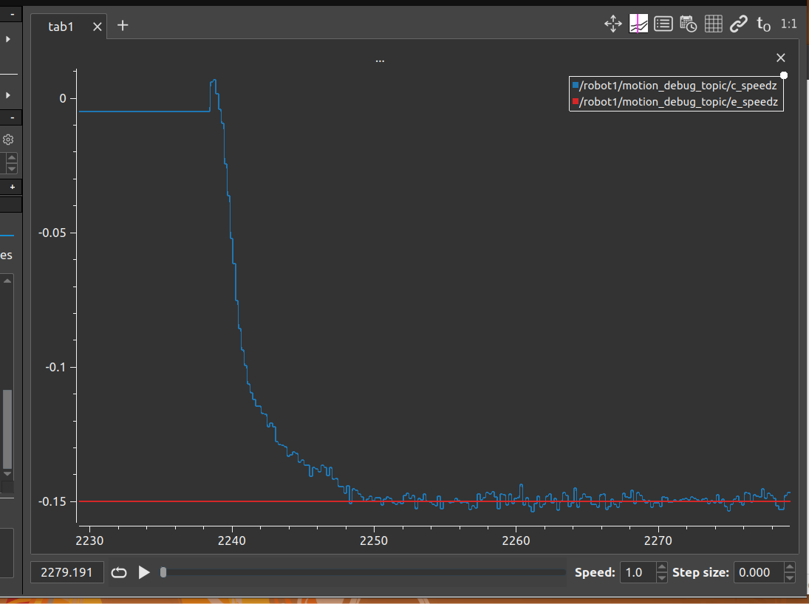
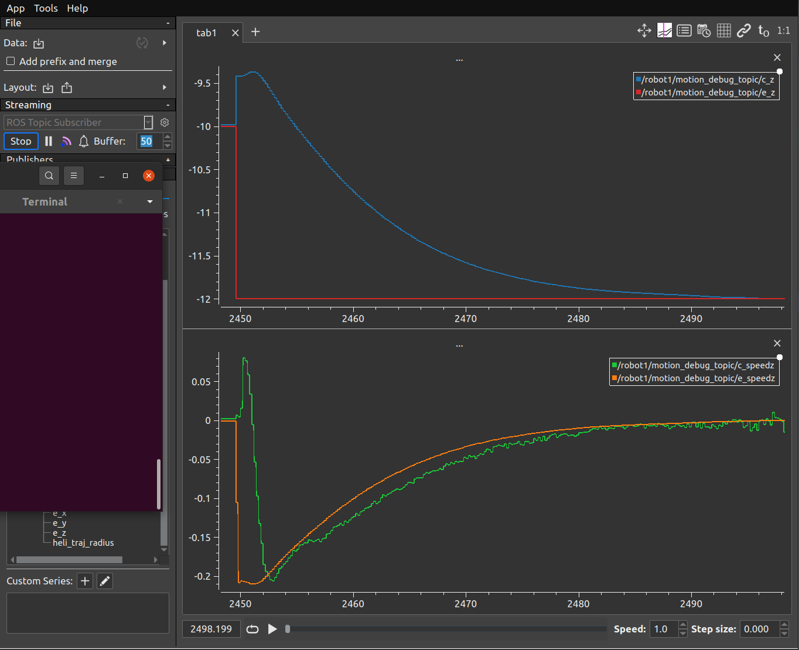
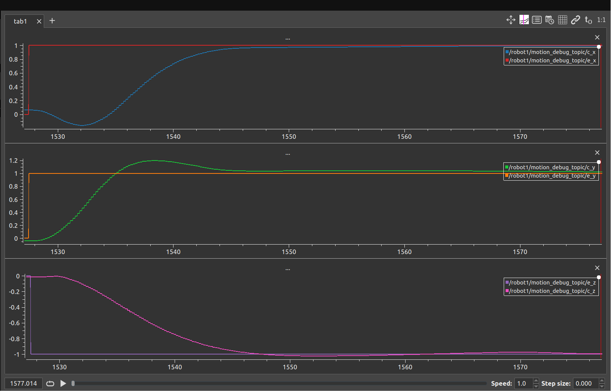
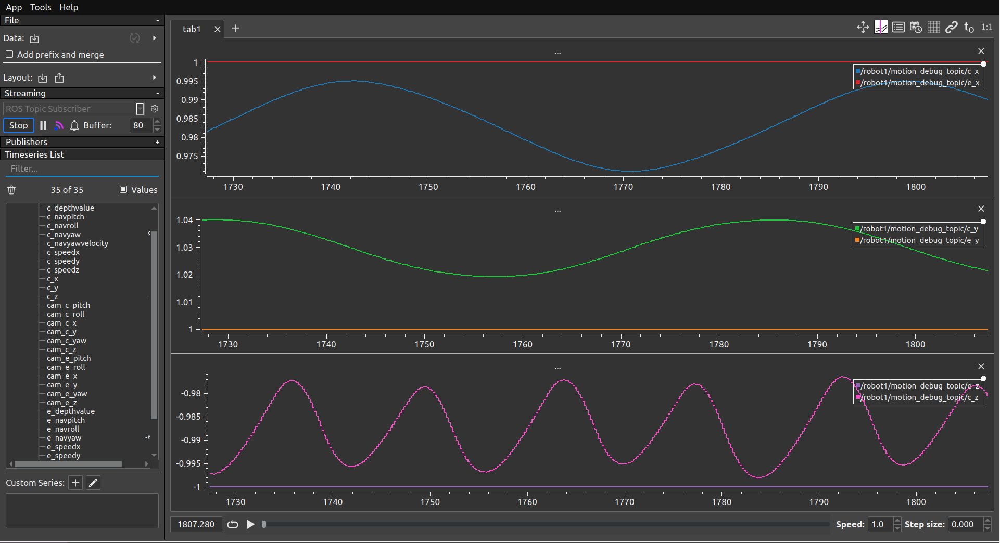
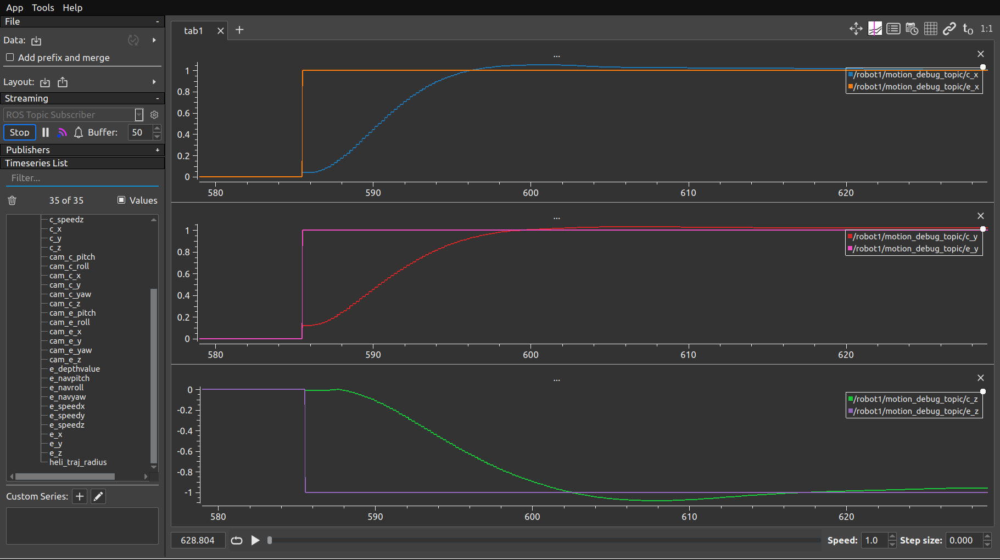
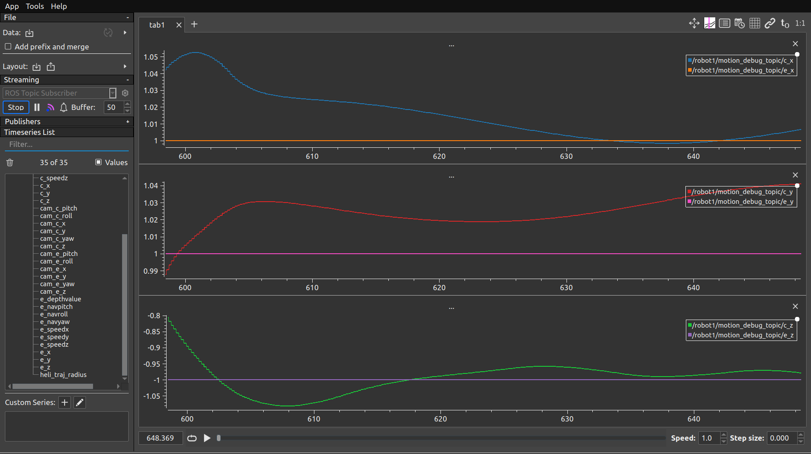
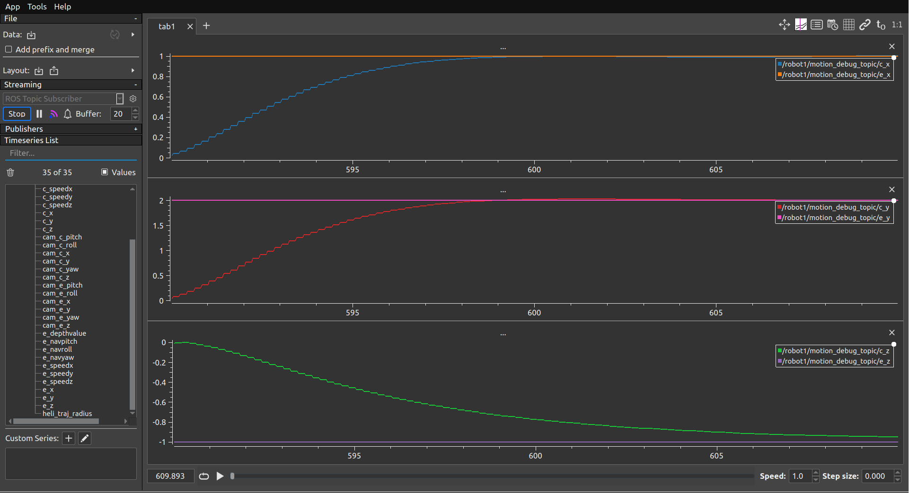
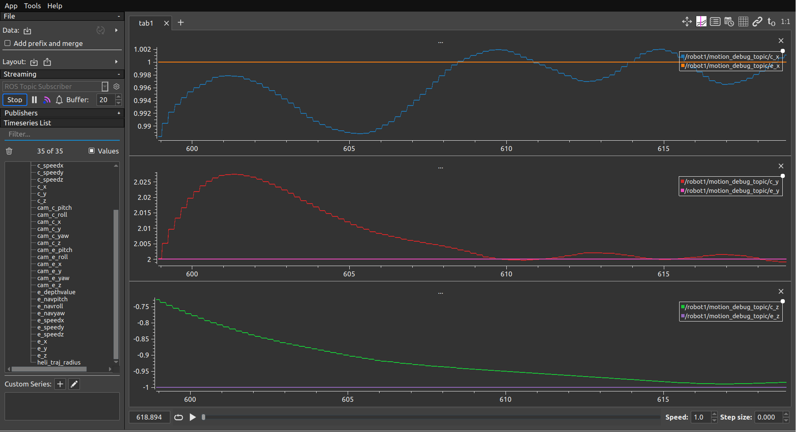
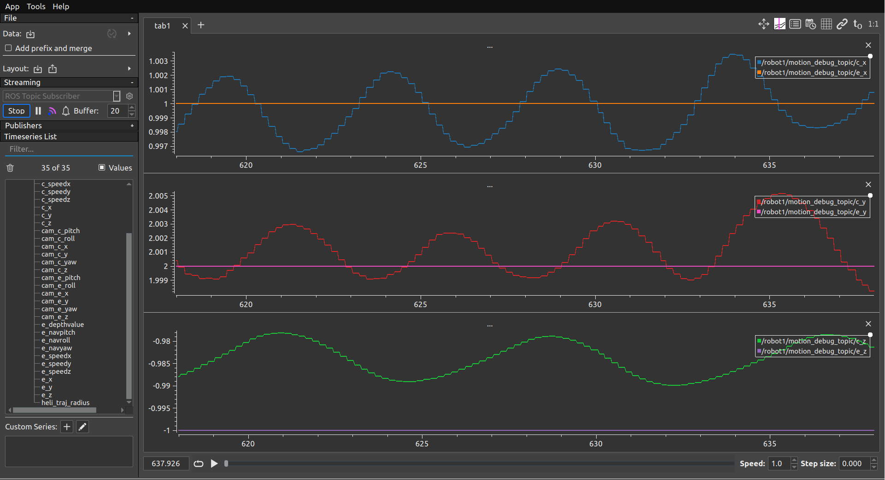

## 程序框架

```
├── config
│   └── camera_gazebo.yaml
├── control.launch~
├── data
├── include
│   ├── asrobot
│   │   ├── adrc.h~
│   │   ├── aruco
│   │   │   ├── aruco_cvversioning.h
│   │   │   ├── aruco_export.h
│   │   │   ├── aruco.h
│   │   │   ├── cameraparameters.h
│   │   │   ├── cvdrawingutils.h
│   │   │   ├── dcf
│   │   │   │   ├── dcfmarkermaptracker.h
│   │   │   │   ├── dcfmarkertracker.h
│   │   │   │   ├── dcf_utils.h
│   │   │   │   └── trackerimpl.h
│   │   │   ├── debug.h
│   │   │   ├── dictionary_based.h
│   │   │   ├── dictionary.h
│   │   │   ├── fractaldetector.h
│   │   │   ├── fractallabelers
│   │   │   │   ├── fractallabeler.h
│   │   │   │   ├── fractalmarker.h
│   │   │   │   ├── fractalmarkerset.h
│   │   │   │   └── fractalposetracker.h
│   │   │   ├── ippe.h
│   │   │   ├── levmarq.h
│   │   │   ├── markerdetector.h
│   │   │   ├── markerdetector_impl.h
│   │   │   ├── marker.h
│   │   │   ├── markerlabeler.h
│   │   │   ├── markermap.h
│   │   │   ├── picoflann.h
│   │   │   ├── posetracker.h
│   │   │   └── timers.h
│   │   ├── ASRModel.h
│   │   ├── cameraparameters.h
│   │   ├── camera_pmt
│   │   │   └── out_camera_calibration.yml
│   │   ├── c_controller_group.h
│   │   ├── c_docking.h
│   │   ├── c_filter_group.h
│   │   ├── c_gaitcontrol.h
│   │   ├── c_legmodel.h
│   │   ├── c_multi_agent_algorithm.h
│   │   ├── com.h
│   │   ├── c_save_data.h
│   │   ├── c_sim_3d_ctrl.h
│   │   ├── c_vectoredthrustcontrol.h
│   │   ├── F_FourLedsSolvePnP.h
│   │   ├── ffttools.h
│   │   ├── fhog.h
│   │   ├── f_multi_robot_plan.h
│   │   ├── f_single_robot_control.h
│   │   ├── gaitcontrol_num3.h~
│   │   ├── generate_trajectory.h
│   │   ├── kcftracker.h
│   │   ├── labdata.h
│   │   ├── legmodel_num1.h
│   │   ├── legmodel_num1.h~
│   │   ├── legmodel_num2.h
│   │   ├── legmodel_num3.h
│   │   ├── MPCController1.h
│   │   ├── MPCController.h
│   │   ├── mpc_formation.h
│   │   ├── mpc.h
│   │   ├── mysvm.h
│   │   ├── OSQP_solver.h
│   │   ├── parameters.h
│   │   ├── qpOASES_solver.h
│   │   ├── quadrotor2robot.h
│   │   ├── recttools.h
│   │   ├── stereocamera_eight.h
│   │   ├── stereocamera.h
│   │   ├── stereovisionpub_eight.h
│   │   ├── stereovisionpub.h
│   │   ├── TCP_client.h
│   │   ├── tracker.h
│   │   └── visualservoing.h
├── launch
│   ├── aruco_det.launch
│   ├── asrobot.launch
│   ├── multi_comm.launch
│   └── README.md
├── msg
│   ├── achievedWaypoint.msg
│   ├── camera82robot (another copy).msg
│   ├── camera82robot.msg
│   ├── camera_data.msg
│   ├── mc.msg
│   ├── mul_ref_trajectory.msg
│   ├── multi_robot8.msg
│   ├── multirobot.msg
│   ├── multirobot.msg~
│   ├── path_2d.msg
│   ├── path_3d.msg
│   ├── path_based_threeSpine.msg
│   ├── Point.msg
│   ├── pwm.msg
│   ├── quadrotor2robot.msg
│   ├── quadrotor2robot.msg~
│   ├── servo.msg
│   ├── status.msg
│   ├── stereo1_pub (copy).msg
│   ├── stereo1_pub.msg
│   ├── stereo2_pub.msg
│   ├── TrackedPose.msg
│   └── Wrench.msg
├── package copy.xml
├── package.xml
├── Readme.md
├── src
│   ├── aruco_det								//aruco码检测
│   │   ├── aruco_demo.cpp
│   │   ├── aruco_det.cpp
│   │   ├── aruco_det_singlemaker.cpp
│   │   ├── aruco_posture.cpp
│   │   ├── aruco.txt
│   │   └── output
│   ├── decision_center							//数据收发
│   │   ├── c_docking.cpp
│   │   ├── c_filter_group.cpp
│   │   ├── c_multi_agent_algorithm.cpp
│   │   ├── c_save_data.cpp
│   │   ├── decision.cpp		
│   │   ├── f_multi_robot_plan.cpp
│   │   └── output
│   ├── gazebo_commu
│   │   ├── joint_control.cpp
│   │   ├── thruster_control.cpp
│   │   ├── thruster_control_eight.cpp
│   │   └── thruster_control_old.cpp
│   ├── man_control								//键盘接口
│   │   └── mancontrol.cpp
│   ├── motion_control							//主控制
│   │   ├── c_controller_group.cpp				//pid、adrc控制器
│   │   ├── c_gaitcontrol.cpp
│   │   ├── c_legmodel.cpp
│   │   ├── c_save_data.cpp
│   │   ├── c_sim_3d_ctrl.cpp					//控制逻辑
│   │   ├── c_vectoredthrustcontrol.cpp			//将力解算分配，包括X、H、H_T、G型
│   │   ├── f_single_robot_control.cpp			//主函数所调用的函数，该函数调用c开头的类的成员方法
│   │   ├── generate_trajectory.cpp
│   │   ├── motion.cpp							//主函数
│   │   ├── MPCController1.cpp
│   │   ├── MPCController.cpp
│   │   ├── mpc_formation.cpp
│   │   ├── OSQP_solver.cpp
│   │   └── qpOASES_solver.cpp
```

## ros命令

```
// 查看当前所有话题
rostopic list 
// 打印某一个具体的话题
rostopic echo /robot1/motion_debug_topic   //该话题是调式机器人位置和PID控制参数

// 订阅调式的数据，生成bag文件
rosbag record -O test_attach_detach.bag /gazebo_robot1/motion_debug_topic /gazebo_robot2/motion_debug_topic    // 订阅/robot1后面的话题，重命名为dock

<param name="robot2_description" command="$(find xacro)/xacro --inorder '$(find gazebo_model)/urdf/box/target_box.xacro'" />
    <node name="spawn_robot2" pkg="gazebo_ros" type="spawn_model"
          args="-param robot2_description -urdf -model robot2 -x 0.5 -y 0 -z -0.5" />


抓：
# attach
rosservice call /link_attacher_node/attach "model_name_1: 'gazebo_robot1'
link_name_1: 'gazebo_robot1/base_link'
model_name_2: 'gazebo_robot2'
link_name_2: 'gazebo_robot2/base_link'"

分：
# detach
rosservice call /link_attacher_node/detach "model_name_1: 'gazebo_robot1'
link_name_1: 'gazebo_robot1/base_link'
model_name_2: 'gazebo_robot2'
link_name_2: 'gazebo_robot2/base_link'"

rosrun xacro xacro $(find gazebo_model)urdf/robot/gazebo_model.xacro namespace:=gazebo_robot1 color:=Orange > ~/final_robot.urdf
```

绪论、机器人重构、单机器人、对接控制


## cmd命令

```
yaw 90        // H型单独调式航向，OK
xyz 1 1 -1    // H型全向控制
depyaw -1 20  // 深度和yaw一起控制
```


### pid调参

- z的调节

​		内环：pidvz 7 0.7 0.4           配合vz (在函数中提前设置好期望的速度，负数为向下)

​		外环：pidpz 0.1 0 0.002		配合pz -1(代表期望位置为-1)

Note：

```
c_sim_3d_ctrl.cpp

//需要调节下面函数的值
void C_Combine3DPidControl::handleShapeX_Control();
bool test_inner_loop_only = false; // 用来内环调参
true为只调内环
```



PID 0.08 0 0.002



PID 0.1, 0, 0.002

## 调式数据

- H型

xyz 1 1 -1           ACCEPTANCE_RADIUS = 0.1m






xyz 1 1 -1           ACCEPTANCE_RADIUS = 0.1m






- X型

xyz 1 2 -1







## 控制部分

### f_single_robot_control

```
三维控制函数
```


### c_sim_3d_ctrl

```
|—— CombineCtrl
|   |——控制过程中的各种标志位
|   |——C_Combine3DControl
```

组合三维控制

**namespace：**CombineCtrl

```
// 矢量控制实例化
C_VectoredThrustControl vec_ctrl;
```


### c_controller_group

控制器的定义

**namespace：**ControllerGroup

```
PID控制器：
ControllerGroup::PID();
float ControllerGroup::PID::pidCalc(float fError);		//增量式PID
float ControllerGroup::PID::pidNewCalc(float fError)	//带积分限幅、滤波的位置式PID
ControllerGroup::PID::pidNewCalc(float expect, float real)；//带滤波的增量式PID
```


## 调用逻辑

```
// mancontrol  ->  motion

// 接收cmd命令，然后根据cmd修改g_current_state全局的当前状态
sub_cmd = n.subscribe("cmd_message", 10, cmdcallback);      // 所有的命令在这个函数里面

// 接收decision中的位置姿态，并更新参数，根据cmd的命令执行对应函数
sub_depth = n.subscribe("mc_message", 100, mccallback);     // 所有要执行的程序在这里


```


```
// 实例化的一个对象，通过这个对象调用函数
CombineCtrl::C_Combine3DPidControl combine3DPidCtrl; 


// 重载，主要甬道的控制函数入口，所有的控制可以直接调用这个函数或者封装起来
// 这个函数只做到把需要的构型和期望当前位姿传递然后调用pidControllerAndOutput
C_Combine3DPidControl::updateControl(
        int shape,
        float exp_p_x, float exp_p_y, float exp_yaw, float exp_p_z,
        float cur_p_x, float cur_p_y, float cur_yaw, float cur_p_z);
        
C_Combine3DPidControl::updateControl(
        int shape,
        float exp_p_x, float exp_p_y, float exp_yaw, float exp_p_z,
        float exp_v_x, float exp_v_y, float exp_v_z,
        float cur_p_x, float cur_p_y, float cur_yaw, float cur_p_z,
        float cur_v_x, float cur_v_y, float cur_v_z)；
        
 
// 控制函数，作为一个管理者，将识别是H还是X型，单环or双环
C_Combine3DPidControl::updatePidControl();

// 分    H型    X型
// 每个控制分单环还是双环控制
        void handleShapeH_DualLoop_Control();
        void handleShapeX_DualLoop_Control();

        void handleShapeX_SingleLoop_Control();
        void handleShapeH_SingleLoop_Control();

// 每个型别下面分debug模式还是正常模式
 enum ControlDebugMode
    {
        NAV_NORMAL,     // 正常导航模式
        DEBUG_Z_ONLY,   // 只调试深度
        DEBUG_YAW_ONLY, // 只调试偏航
        DEBUG_X_ONLY,    // 只调试前进 (需要先调好Yaw)
        DEBUG_DEPYAW_ONLY
    };
  // --- 新增：用于存储调试模式和目标的私有成员变量 ---
 ControlDebugMode current_debug_mode_;  
```

## 控制部分

```
// NAV_NORMAL
// 前进控制器、航向控制器、深度控制器

// 计算当前与期望的（X,Y）之间的直线差，作为前进控制器的输入量
// Y的偏差与X的偏差的反正切角度作为目标的期望航向
// 深度正常控制

// 到达目标点附近ACCEPTANCE_RADIUS半径0.05m，停止运动；如果航向偏差大于15度，则优先控制转得更快
```


实现H型XYZ直接运动

实现X型XYZ直接运动

实现H型控制深度和YAW，但是不能用于第二阶段，H型的YAW和前进的是耦合的


